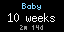

# Baby Age for Tidbyt

Shows how old your baby is, sized to the stage they're at.

In automatic mode the age is shown in hours on the first day, then days up to 30 days, weeks up to 24 weeks, months up to 2 years, and years after that. A smaller line underneath gives the exact age, like `2m 14d` or `1y 3m`.

## Settings

- **Name**: your baby's name. Long names scroll.
- **Birthdate**: date and time of birth. Set a date in the future to count down to the due date instead.
- **Show age in**: automatic, or always hours, days, weeks, months or years.
- **Show breakdown**: show or hide the exact-age line.
- **Name color**: color of the name.
